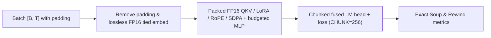

> **This branch is the 3029 MiB memory experiment.** Its Colab T4 result is **58.06 s**, with all 10 checks passing. See [measurements and exact reproduction commands](MEMORY_EXPERIMENT.md). This is not a sub-40-second result and has not yet been measured on Kaggle. The original submission documentation below describes the separately pinned `fabc67d` source, not this branch's current `solution/`.

# Soup Kernel Challenge — Decentrathon 6.0

[Русский](README.ru.md) · [Submission](SUBMISSION.md)

   

[<kbd>Open in Kaggle</kbd>](https://www.kaggle.com/code/iencis/decentrathon-soup-kernel-final) · Final commit: [`fabc67d4b0667be70b846aac29d9be21cb31a212`](https://github.com/alikhan-kai/decentrathon/commit/fabc67d4b0667be70b846aac29d9be21cb31a212) ([hackathon mirror](https://github.com/BAITC-Hacks/hack-d2097b50-localhost/commit/fabc67d4b0667be70b846aac29d9be21cb31a212))

Custom Triton kernels, padding-free per-batch execution, native FP16 attention/MLP activation paths and lossless tied-weight compaction accelerate Qwen2.5-1.5B-Instruct LoRA training while cutting peak VRAM by **4.37×** (`14 345 MiB -> 3 279 MiB`). The fixed task uses Soup 0.77.0, 4-bit NF4 double-quantized weights, LoRA rank 16 (`q_proj`, `v_proj`), 256 Kazakh instruction examples, batch size 4, maximum length 512 and one epoch of 64 steps on a single Kaggle Tesla T4. LoRA targets, dropout, optimizer, schedule and output metrics are preserved. **Final submission-source run F — public rows, seed 1, `--repeats 2` (ABBA)** <a id="results"></a><a id="результаты"></a>

| Measurement | Base Soup | Solution | Comparison |
|---|---:|---:|---|
| Whole command, s (ABBA median) | 84.59 | 53.19 | Speedup **1.5903×** |
| Peak GPU memory, MiB (`nvidia-smi` max) | 14345 | 3279 | Base/solution **4.3748×** |
| Held-out eval loss | 2.04965 | 2.04941 | **−0.012%** |
| Own-kernel share, lowest repeat | Not applicable | 10.9% | Required ≥5% |

> [!NOTE]
> Paired two-repeat ABBA (`base_1 -> solution_1 -> solution_2 -> base_2`) T4 wall times in F were **84.18 / 52.74 / 53.64 / 85.01 s** (`50.59 s` on a single cool-GPU run), with `3279 MiB` peak memory (`3002.5 MiB` `torch_max_allocated`) on every solution run. All automatic checks 1–10 passed, including the 79 Soup regression tests. Full hashes, per-kernel timings and earlier milestones are in [Evidence](docs/EVIDENCE.md).

## How it works



- **Chunked fused LM head (`CHUNK=256`):** compute cross-entropy loss, token entropy and argmax accuracy in one Triton pass over 256-token chunks without materializing `[B, T, 151936]` FP32 logits; compact valid rows and recompute scaled FP16 `dlogits` in backward.
- **Fused nested NF4 + direct 4-bit matmul, RMSNorm & joint Q/K RoPE in Triton:** fuse bitsandbytes' double-quantized (`nested=True`) `absmax` decoding directly into `nf4_dequant_kernel` with IEEE-754 `mul.rn.f32` / `add.rn.f32`, fuse forward/backward `Qwen2RMSNorm`, and run joint Q/K split-half RoPE (`ember_rope_joint`) directly in FP16.
- **Padding-free within-batch execution & native FP16 attention:** pack real tokens within each batch while keeping causal SDPA strictly isolated per example, running `QKV -> fused LoRA epilogue -> RoPE -> batched repeat_kv -> SDPA -> o_proj` in FP16 with an exact FP32 residual boundary.
- **Lossless FP16 tied embedding/head weight & budgeted MLP saves:** verify bit-exact FP32↔FP16 round-trip on the frozen tied `embed_tokens` / `lm_head` parameter (`-467 MiB` VRAM), and combine zero-cast FP16 SwiGLU saves with selective frozen-branch rematerialization above `BUDGET_ROWS = 940`.
- **Startup & compilation overlap:** `solution.apply()` applies `overhead -> swiglu -> head_loss -> rmsnorm -> nf4 -> lora -> rotary -> precompile`, followed by `packed` and saved-activation MLP installation; `precompile` warms up the exact 9 training Triton specializations on one background thread while Soup loads and quantizes the model.

## What changed

`mq` denotes `transformers.models.qwen2.modeling_qwen2`. Effects describe mechanisms; isolated final-module gains are not additive and require individual on/off ABBA runs on a T4. Full provenance and hashes are in [Evidence](docs/EVIDENCE.md).

| Module | What it replaces / hooks | Own Triton kernel | Effect and idea source |
|---|---|---|---|
| [head_loss.py](solution/head_loss.py) | `mq.Qwen2ForCausalLM.forward`; `trl.SFTTrainer.compute_loss` | Yes: `head_loss_kernel` | Chunked `[256, V]` logits, joint loss/entropy/accuracy, compacted backward, async index scatter; chunking idea from Soup `stream_loss_chunk`. |
| [nf4.py](solution/nf4.py) | `bnb` `_dequantize_4bit_impl`, `dequantize_4bit`, `matmul_4bit` | Yes: `nf4_dequant_kernel` | Bit-exact nested double-quant + flat NF4 unpacking in one kernel and `_FastNF4MatMul` dispatcher bypass; QLoRA NF4 and bitsandbytes 0.50.2 semantics. |
| [rmsnorm.py](solution/rmsnorm.py) | `mq.Qwen2RMSNorm.forward` | Yes: `rmsnorm_fwd_kernel`, `rmsnorm_bwd_kernel` | Single-launch FP32 RMS reduction, scale and input-gradient kernels; Qwen2 semantics. |
| [rotary.py](solution/rotary.py) | `mq.apply_rotary_pos_emb` | Yes: `ember_rope_joint` | Joint Q/K split-half rotation in FP16/FP32 saving only `cos`/`sin` for backward; Qwen2 semantics. |
| [lora.py](solution/lora.py) | `peft.tuners.lora.bnb.Linear4bit.forward` | No | Removes redundant `.clone()` on base output (`56 × 6.3 MB/step`) and fuses scale+add via `torch.add(..., alpha=scaling)`. |
| [packed.py](solution/packed.py), [attention_adapter.py](solution/attention_adapter.py), [attention_gqa.py](solution/attention_gqa.py) | `mq.Qwen2Model.forward`; `mq.Qwen2Attention.forward` | No | Removes right-padding per batch while keeping per-example causal SDPA isolated; runs native FP16 QKV/LoRA/RoPE and whole-layer FP16 `repeat_kv` on T4 with HF fallback. |
| [frozen_weight.py](solution/frozen_weight.py) | `torch.nn.Embedding.forward`; `torch.nn.Linear.forward` (tied frozen weight) | No | Stores the frozen tied `[151936, 1536]` weight in FP16 only after verifying bit-exact FP32 round-trip, cutting ~467 MiB VRAM. |
| [swiglu_pack.py](solution/swiglu_pack.py), [native_half.py](solution/native_half.py), [hybrid_mlp.py](solution/hybrid_mlp.py), [frozen_remat.py](solution/frozen_remat.py) | Guarded `mq.Qwen2MLP.forward` | No; reuses starter SwiGLU | Native FP16 gate/up activation saves within a `BUDGET_ROWS=940` layer budget and frozen-branch rematerialization above budget. |
| [overhead.py](solution/overhead.py), [lazy_bnb_compile.py](solution/lazy_bnb_compile.py) | `packages_distributions`, `caching_allocator_warmup`, `Dataset.map`, `sft.resolve_device_map`, `sft._map_text_sft_rows`, `bnb` import `@torch.compile` | No | Reuses Transformers' in-process package metadata, skips eager warmup spike and unused import-time `bnb` `torch.compile`, places directly on GPU 0, builds tokenized dataset in memory and avoids redundant in-memory tokenizer pickle-hashing. |
| [precompile.py](solution/precompile.py) | Background `kernel.warmup` worker started at the end of `apply()` | No (compiles existing kernels) | Overlaps compilation of the exact 9 training Triton specializations with C++/CUDA model loading using per-kernel readiness events. |
| [swiglu.py](solution/swiglu.py) | Initial `mq.Qwen2MLP.forward` | Starter `example_swiglu_*` (**not ours**) | Organizer's fused SwiGLU from the starter kit; excluded from Check 4 eligible kernel share. |
| [residual_norm.py](solution/residual_norm.py) | Disabled optional decoder residual+norm fusion | Not launched | Disabled (`ENABLED=False`, not in registry); kept only with unit tests. |

<details><summary>Head loss kernel (<code>head_loss_kernel</code>)</summary>

`head_loss_kernel` scans the `151,936`-token vocabulary in `BLOCK=2048` tiles with an online softmax reduction to emit per-token cross-entropy loss, Shannon entropy and argmax hit in one pass (`CHUNK=256`).
Backward compacts non-ignored target rows (`target >= 0`), recomputes `256`-row FP16 logit chunks, scales `softmax - onehot` in FP32 by `grad_loss / denom` before rounding to FP16, and accumulates `dlogits @ W` via `index_copy_`. The frozen `lm_head` requires no weight gradient. Tested in [test_head_loss.py](solution/test_head_loss.py) and [test_head_fallback.py](solution/test_head_fallback.py).
</details>

<details><summary>NF4 unpacking kernel (<code>nf4_dequant_kernel</code>)</summary>

`nf4_dequant_kernel` unpacks high and low 4-bit nibbles (`[512, 2]` weights per program, `BLOCKSIZE=64`). When `NESTED=True`, it fuses bitsandbytes' double-quantized `absmax` decoding (`code2[qabs] * absmax2 + offset`) directly inside the kernel using inline PTX `mul.rn.f32` followed by `add.rn.f32` (preventing FMA contraction so outputs match `bitsandbytes.functional.dequantize_4bit` bit-for-bit with `torch.equal`). `_FastNF4MatMul` routes eligible nested NF4 `matmul_4bit` calls (`M >= 64` on `sm_75`) directly through `dequantize_nf4_nested` + cuBLAS `linear` / `matmul` in forward and backward. Tested in [test_nf4.py](solution/test_nf4.py).
</details>

<details><summary>RMSNorm kernels (<code>rmsnorm_fwd_kernel</code>, <code>rmsnorm_bwd_kernel</code>)</summary>

`rmsnorm_fwd_kernel` computes the FP32 row mean-square, `rsqrt(var + eps)` and weighted output in one launch across all 57 `Qwen2RMSNorm` calls per step (`BLOCK=2048, num_warps=4`). `rmsnorm_bwd_kernel` computes `dx = rstd * (dy * w - xhat * mean(dy * w * xhat))` in FP32; if a trainable norm weight is ever passed, `dw` falls back cleanly to PyTorch. Tested in [test_rmsnorm.py](solution/test_rmsnorm.py).
</details>

<details><summary>Rotary kernel (<code>ember_rope_joint</code>)</summary>

`ember_rope_joint` rotates `Q` (12 heads) and `K` (2 KV heads) in a single launch per direction with `do_not_specialize` on dynamic packed token counts and strides, `enable_fp_fusion=False`, and explicit per-product rounding so both FP16 and FP32 calls match eager Qwen2 arithmetic bit-for-bit while saving only `cos` and `sin` for backward. `_rope_rotate_block` is an inlined `@triton.jit` device helper. Tested in [test_rotary.py](solution/test_rotary.py).
</details>

## Run it

1. Import or open the configured [submission notebook](submission/kaggle_notebook.ipynb) ([Kaggle link](https://www.kaggle.com/code/iencis/decentrathon-soup-kernel-final)), which pins `COMMIT = "fabc67d4b0667be70b846aac29d9be21cb31a212"` and runs `--repeats 2`.
2. Select **Accelerator: GPU T4 x2** (the harness isolates GPU 0) and keep the GPUs idle.
3. Turn **Internet: on** (add `HF_TOKEN` in Kaggle Secrets if rate-limited by Hugging Face).
4. Click **Save & Run All** (or **Run All**) and verify `ALL CHECKS PASSED` in `harness/check_rules.py` along with `runs/result.json` and `runs/checks.json`.

<details><summary>Linux / CUDA commands</summary>

Start with the recorded CUDA PyTorch/Triton environment below (`Tesla T4`, Python 3.13, `torch 2.11.0+cu128`, `triton 3.6.0`). Package installation happens outside the measured process.

```bash
git clone https://github.com/alikhan-kai/decentrathon.git
cd decentrathon
git checkout fabc67d4b0667be70b846aac29d9be21cb31a212
python -m pip install "soup-cli[train]==0.77.0" "transformers==5.16.1" \
  "peft==0.20.0" "trl==0.29.1" "bitsandbytes==0.50.2" \
  "accelerate==1.14.0" "datasets==4.8.5" pytest
python task/prepare_data.py
SOUP_APPLY_SOLUTION=1 python -m pytest tests -q
python harness/run_task.py --repeats 2
python harness/check_rules.py
python harness/score.py runs/result.json
```

Outputs are written to `runs/result.json`, `runs/checks.json`, per-run `train.log` / `metrics.json` and `adapter/`. Add `--profile` to `run_task.py` for a CUDA kernel profile table.
</details>

## Validation <a id="correctness-validation"></a><a id="как-проверяли-корректность"></a>

Automatic checks **1–10: F PASS (2 base + 2 solution runs); earlier `632851f` / P / R PASS**. All **79 Soup regression tests passed** (`0.49 s` in F). Unit tests in `solution/test_*.py` verify forward values, backward gradients, odd/tail shapes, precompile cache hits (`0` extra variants compiled at runtime) and fallback guards against PyTorch and bitsandbytes references. Automatic checks do not replace jury code review.

<details><summary>Check 1–10 results for final run F (<code>fabc67d</code>)</summary>

| Automatic check | F (`fabc67d`, `--repeats 2`) | Earlier R (`seed 7`, other rows) |
|---|---|---|
| 1. All base and solution runs finish | PASS (2 base, 2 solution) | PASS |
| 2. No prohibited kernel libraries or runtime installs | PASS | PASS |
| 3. Own `@triton.jit` kernels execute in training | PASS (`ember_rope_joint`, `head_loss_kernel`, `nf4_dequant_kernel`, `rmsnorm_fwd_kernel`, `rmsnorm_bwd_kernel`) | PASS |
| 4. Own-kernel share ≥5% (lowest repeat, steps 3+) | PASS: **10.9%** | PASS: 10.0% |
| 5. Same task, adapter structure, metrics and rewind | PASS | PASS |
| 6. Training loss curve within tolerance (≤1% / ≤3%) | PASS: **0.01% first / 0.05% mean** | PASS: 0.00% / 0.05% |
| 7. Eval loss at most +0.5% above base | PASS: **−0.012%** | PASS: +0.017% |
| 8. Time and memory within 1.10× of base | PASS: **time ×0.629, memory ×0.229** | PASS |
| 9. Clean T4 measurement | PASS (`clean`) | PASS |
| 10. Soup regression suite with patches applied | PASS: **79 passed in 0.49s** | PASS: 79 passed |

Tracked file: [`docs/measurements/submission_fabc67d/checks.json`](docs/measurements/submission_fabc67d/checks.json).
</details>

## Additional measurements and environment

<details><summary>Earlier milestones (<code>632851f</code>, P, R) and recorded environment</summary>

| Milestone / dataset | Base Soup | Solution | Comparison |
|---|---:|---:|---|
| Final `F` (`fabc67d`), public, seed 1: whole command, s | 84.59 | 53.19 | Speedup **1.5903×** |
| Final `F` (`fabc67d`), public: peak GPU memory, MiB | 14345 | 3279 | Base/solution **4.3748×** |
| Earlier `632851f`, public, seed 1: whole command, s | 83.25 | 59.66 | Speedup 1.3954× |
| Earlier `632851f`, public: peak GPU memory, MiB | 14345 | 4421 | Base/solution 3.2447× |
| Earlier `P` (`e0eed88`), public, seed 1: whole command, s | 89.66 | 67.08 | Speedup 1.3366× |
| Earlier `R` (`952f20a`), rows 1000–1255, seed 7: whole command, s | 81.68 | 61.91 | Speedup 1.3193× |
| Earlier `R` (`952f20a`), rows 1000–1255: peak GPU memory, MiB | 14351 | 4405 | Base/solution 3.2579× |
| Earlier `R` (`952f20a`), rows 1000–1255: held-out loss | 2.11513 | 2.11550 | +0.017% |

| Recorded Kaggle T4 environment | Version |
|---|---|
| Python | 3.13.15 |
| Soup (`soup-cli`) | 0.77.0 |
| PyTorch | 2.11.0+cu128 |
| Triton | 3.6.0 |
| Transformers / PEFT / TRL | 5.16.1 / 0.20.0 / 0.29.1 |
| bitsandbytes / Accelerate / datasets | 0.50.2 / 1.14.0 / 4.8.5 |
| GPU / driver | Tesla T4 (16 GiB, `sm_75`) / 580.178.04 |

Each paired comparison uses `run_task.py --repeats 2` (**base → solution → solution → base**) on one visible Tesla T4, with empty compiler caches at the start of every run, `nvidia-smi` peak memory polling, and CUDA-event timing of custom kernels in `solution/` from step 3 onward.
</details>

## Limitations and unsuccessful work <a id="limitations-and-unsuccessful-work"></a><a id="ограничения-и-что-не-получилось"></a>

- **Workload specificity.** Fast paths target Qwen2.5-1.5B FP16 AMP LoRA training on Tesla T4 (`sm_75`) with the pinned library versions. Unsupported dtypes (such as BF16), architectures, hooks, higher-order gradients or `torch.compile` tracing fall back to the saved upstream methods.
- **Starter SwiGLU hash guard.** Saved-activation MLP packing verifies the SHA-256 of `solution/swiglu.py` (`e1dc639838c4c46ea0ed0aec3f0d904d360c92a91c601b943c9cfef85ca21c64`) and first-order eager guards before activating; we claim zero original-kernel credit for `example_swiglu_*`.
- **MLP memory/compute tradeoff.** Above `BUDGET_ROWS = 940` packed tokens, excess upper decoder layers rematerialize `gate_proj` and `up_proj` in backward (`~241` layer calls across 64 steps) to hold peak memory at `3 279 MiB`.
- **Unsuccessful NF4 3D tiling experiment.** Factoring `nf4_dequant_kernel` into a 3D `[16, 32, 2]` tile with a 15-way register `tl.where` codebook tree (`1345af8`) disrupted 128-bit store coalescing on `sm_75` and regressed `nf4_dequant_kernel` from `2.49 s` to `4.04 s`; reverting to the coalesced 2D `[512, 2]` layout in `fabc67d` restored full speed while keeping `3 279 MiB`.
- **Disabled residual/norm fusion.** `residual_norm.py` showed no net end-to-end training wall-time improvement over standalone `rmsnorm` + `rotary` and remains disabled.
- **Numerical & environment notes.** Removing padding changes dropout RNG consumption order relative to padded shapes, though step-1 loss (`0.01%`), mean curve gap (`0.05%`) and eval loss (`−0.012%`) remain far inside the `1% / 3% / +0.5%` thresholds. On default Kaggle images with mismatched preinstalled `torchao 0.10.0`, running `pytest solution` directly can hit 5 PEFT `torchao >= 0.16.0` import errors in optional fallback tests; the official 79 Soup regressions and all 10 harness checks pass cleanly.

## Next steps

| Experiment | Rationale and expected benefit | Validation required |
|---|---|---|
| Fused NF4 dequant + skinny GEMM epilogue/prologue | `nf4_dequant_kernel` accounts for ~8.3% of timed training (`~2.65 s` across 62 steps) writing temporary FP16 weights to DRAM before cuBLAS reads them back. | Custom `sm_75` MMA/SIMT tile benchmarked against cuBLAS Tensor Cores in a 2-repeat ABBA run while keeping Check 4 ≥5%. |
| Varlen block-diagonal `sm_75` FlashAttention in Triton | Packed attention currently loops `F.scaled_dot_product_attention` over the 4 examples per layer and materializes `repeat_kv` (`2 -> 12` heads). | Bit-bounded causal GQA forward/backward kernel on `head_dim=128` with zero cross-example leakage and full Check 5–7 parity. |
| Fuse `gate_proj` + `up_proj` dequant/GEMM launch | Concatenating or batching frozen MLP projections could cut launch overhead during both forward and rematerialized backward. | Verify identical rounding, peak VRAM ≤3300 MiB and zero adapter/hook regressions. |

## Team and sources

Official roster, roles and media links are tracked in [SUBMISSION.md](SUBMISSION.md). Below are Git contribution credits from repository history:

| Contributor | Recorded work | Evidence |
|---|---|---|
| Ansar / `iencislennon` | Chunked head loss, NF4 kernel, RMSNorm kernels, packed decoder, integration and T4 measurements | Commits `69a595d`, `ca90121`, `c0cc1c8`; [Evidence](docs/EVIDENCE.md) |
| `stritphatographir` | Joint Q/K rotary kernel, corrected head gradients/guards, lossless FP16 tied weight, native/hybrid MLP saves and background precompilation | Commits `05543d7`, `5b4dd1f`, `59755b0`, `cf40d48`, `fabc67d` |
| `Alikhan-kai` | Startup overhead reduction, fused LoRA epilogue, nested NF4 integration and fast dataset mapping | Commits `44d1a47`, `c71ad48`, `2cfa86c`; [merge record](docs/MERGE_OVERHEAD.md) |

- **Makazhan Alpamys and Soup contributors:** [Soup](https://github.com/MakazhanAlpamys/Soup), the [challenge starter kit](https://github.com/MakazhanAlpamys/soup-kernel-challenge) and the [head-chunking idea](https://github.com/MakazhanAlpamys/Soup/blob/main/src/soup_cli/utils/stream_loss_chunk.py) (`stream_loss_chunk`, Apache-2.0). Our `head_loss_kernel` is an original Triton implementation. Zero original-kernel credit is claimed for starter `example_swiglu_*`.
- **Tim Dettmers, Artidoro Pagnoni, Ari Holtzman and Luke Zettlemoyer:** [QLoRA](https://arxiv.org/abs/2305.14314) defines NF4 and double quantization; [bitsandbytes 0.50.2](https://github.com/bitsandbytes-foundation/bitsandbytes/blob/0.50.2/bitsandbytes/backends/cuda/ops.py) defines reference unpacking semantics.
- **Hugging Face Transformers & PEFT contributors:** [Qwen2 modeling](https://github.com/huggingface/transformers/blob/v5.16.1/src/transformers/models/qwen2/modeling_qwen2.py) and PEFT 0.20.0 define reference RMSNorm, RoPE, SDPA and LoRA behavior.
- **Licenses:** Repository code and starter kit are [Apache-2.0](LICENSE) ([NOTICE](NOTICE)); [Qwen2.5-1.5B-Instruct](https://huggingface.co/Qwen/Qwen2.5-1.5B-Instruct) is Apache-2.0; [AmanMussa/kazakh-instruction-v2](https://huggingface.co/datasets/AmanMussa/kazakh-instruction-v2) lists MIT (derived from [Stanford Alpaca](https://huggingface.co/datasets/tatsu-lab/alpaca), CC BY-NC 4.0). Model weights and datasets are downloaded at runtime and never bundled.

## Repository layout

```text
solution/    Runtime patches, custom Triton kernels and unit tests; copied by the jury.
task/        Fixed training configuration and public Kazakh dataset preparation.
harness/     Organizer measurement, adapter evaluation, rule checks and scoring.
tests/       79 Soup regression tests run with SOUP_APPLY_SOLUTION=1.
submission/  Configured Kaggle notebook pinning the final commit SHA and --repeats 2.
tools/       Notebook builder, local lint, profiling and summary scripts.
docs/        Rules, measurement evidence, provenance and design notes.
notes/       Chronological experiment log.
templates/   Organizer starter notebook and SUBMISSION.md template.
```
