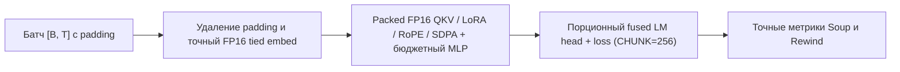

> **This branch is the 3029 MiB memory experiment.** Its Colab T4 result is **58.06 s**, with all 10 checks passing. See [measurements and exact reproduction commands](MEMORY_EXPERIMENT.md). This is not a sub-40-second result and has not yet been measured on Kaggle. The original submission documentation below describes the separately pinned `fabc67d` source, not this branch's current `solution/`.

# Soup Kernel Challenge — Decentrathon 6.0 (Русская версия)

[English](README.md) · [Сдача / Submission](SUBMISSION.md)

   

[<kbd>Открыть в Kaggle</kbd>](https://www.kaggle.com/code/iencis/decentrathon-soup-kernel-final) · Финальный коммит: [`fabc67d4b0667be70b846aac29d9be21cb31a212`](https://github.com/alikhan-kai/decentrathon/commit/fabc67d4b0667be70b846aac29d9be21cb31a212) ([зеркало хакатона](https://github.com/BAITC-Hacks/hack-d2097b50-localhost/commit/fabc67d4b0667be70b846aac29d9be21cb31a212))

Собственные Triton-кернелы, упаковка токенов без padding внутри батча, нативный `FP16`-конвейер в attention/MLP и сжатие без потерь связанной матрицы эмбеддингов/головы ускоряют обучение LoRA для `Qwen2.5-1.5B-Instruct` в **1.59×** и снижают пик видеопамяти в **4.37×** (`14 345 MiB -> 3 279 MiB`). Фиксированная задача сохранена полностью: `soup-cli 0.77.0`, 4-bit NF4 с двойным квантованием, LoRA ранга 16 (`q_proj`, `v_proj`), dropout `0.05`, 256 казахских инструкций, батч 4, `max_length=512`, 1 эпоха (64 шага) на одной GPU Kaggle Tesla T4. **Финальный замер сдаваемого кода F — публичные строки, seed 1, `--repeats 2` (ABBA)** <a id="результаты"></a>

| Показатель | База Soup | Наше решение | Сравнение |
|---|---:|---:|---|
| Вся команда `soup train`, с (медиана ABBA) | 84.59 | 53.19 | Ускорение **1.5903×** |
| Пик памяти GPU, MiB (максимум `nvidia-smi`) | 14345 | 3279 | База/решение **4.3748×** |
| Качество (`eval loss` на отложенной выборке) | 2.04965 | 2.04941 | **−0.012%** (лучше базы) |
| Доля своих Triton-кернелов, худший повтор | Не применяется | 10.9% | Требуется ≥5% |

> [!NOTE]
> В парном прогоне ABBA (`base_1 -> solution_1 -> solution_2 -> base_2`) времена составили **84.18 / 52.74 / 53.64 / 85.01 с** (на одиночном прогоне холодной карты — **50.59 с**), а пик памяти на обоих повторах решения держался ровно на **3279 MiB** (`torch_max_allocated = 3002.5 MiB`). Все автоматические проверки 1–10 и 79 регрессионных тестов Soup прошли успешно. Полные хэши и разбивка по кернелам — в [Evidence](docs/EVIDENCE.md).

## Как устроено решение



- **Порционная объединённая голова и loss (`CHUNK=256`):** вычисляет cross-entropy, энтропию токенов и точность `argmax` за один проход Triton-кернела по чанкам из 256 токенов без материализации полного тензора `[B, T, 151936]` в `FP32`; в backward сжимает только активные позиции (`target >= 0`) и пересчитывает масштабированные `FP16`-градиенты.
- **Объединённая распаковка вложенного NF4 + прямой 4-bit matmul, RMSNorm и совместный Q/K RoPE на Triton:** декодирование второго уровня квантования (`nested=True`) встроено прямо в `nf4_dequant_kernel` через IEEE-754 `mul.rn.f32` и `add.rn.f32` (побитовое совпадение с `bitsandbytes`); `Qwen2RMSNorm` объединён в forward/backward; `ember_rope_joint` вращает `Q` и `K` одним запуском в нативном `FP16`.
- **Удаление padding внутри батча и нативный `FP16`-конвейер внимания:** убирает правый padding без смешивания внимания между примерами батча; цепочка `QKV -> fused LoRA epilogue -> RoPE -> общий repeat_kv -> SDPA -> o_proj` работает в `FP16` с точным возвратом в `FP32` для residual-потока.
- **Сжатие без потерь связанного веса `embed_tokens`/`lm_head` и бюджет памяти MLP:** замороженная матрица `[151936, 1536]` переводится в `FP16` только после побитовой проверки обратимости `FP32 <-> FP16` (экономия `~467 MiB` VRAM), а в MLP сохраняются `FP16`-активации в рамках бюджета `BUDGET_ROWS = 940` с выборочным пересчётом замороженных `gate/up` на длинных батчах.
- **Сокращение накладных расходов старта и фоновая прекомпиляция:** `solution.apply()` запускает модули в порядке `overhead -> swiglu -> head_loss -> rmsnorm -> nf4 -> lora -> rotary -> precompile`, затем подключает `packed` и упаковку активаций MLP; `precompile` компилирует ровно 9 боевых специализаций Triton в одном фоновом потоке параллельно загрузке и квантованию модели.

## Что изменено по модулям

`mq` обозначает `transformers.models.qwen2.modeling_qwen2`. Эффекты описывают механизм работы; изолированный вклад каждого модуля не аддитивен. Подробности и хэши приведены в [Evidence](docs/EVIDENCE.md).

| Модуль | Что заменяет / перехватывает | Свой Triton-кернел | Эффект и источник идеи |
|---|---|---|---|
| [head_loss.py](solution/head_loss.py) | `mq.Qwen2ForCausalLM.forward`; `trl.SFTTrainer.compute_loss` | Да: `head_loss_kernel` | Чанки `[256, V]`, совместный расчёт loss/entropy/accuracy, уплотнение активных строк в backward; идея чанков из Soup `stream_loss_chunk`. |
| [nf4.py](solution/nf4.py) | `bnb` `_dequantize_4bit_impl`, `dequantize_4bit`, `matmul_4bit` | Да: `nf4_dequant_kernel` | Побитово точная распаковка вложенного (`nested=True`) и обычного NF4 за один запуск + прямой `_FastNF4MatMul`; формат QLoRA NF4 и `bitsandbytes 0.50.2`. |
| [rmsnorm.py](solution/rmsnorm.py) | `mq.Qwen2RMSNorm.forward` | Да: `rmsnorm_fwd_kernel`, `rmsnorm_bwd_kernel` | Однопроходные `FP32`-редукции и градиенты входа для 57 вызовов за шаг; семантика Qwen2. |
| [rotary.py](solution/rotary.py) | `mq.apply_rotary_pos_emb` | Да: `ember_rope_joint` | Совместное вращение Q и K в `FP16`/`FP32` с сохранением только `cos`/`sin` для backward; семантика Qwen2. |
| [lora.py](solution/lora.py) | `peft.tuners.lora.bnb.Linear4bit.forward` | Нет | Убирает лишний `.clone()` выхода базового слоя (`56 × 6.3 МБ/шаг`) и объединяет `scale + add` через `torch.add(..., alpha=scaling)`. |
| [packed.py](solution/packed.py), [attention_adapter.py](solution/attention_adapter.py), [attention_gqa.py](solution/attention_gqa.py) | `mq.Qwen2Model.forward`; `mq.Qwen2Attention.forward` | Нет | Удаление правого padding внутри батча с изолированным causal SDPA по примерам, нативный `FP16` QKV/LoRA/RoPE и послойный `FP16` `repeat_kv`. |
| [frozen_weight.py](solution/frozen_weight.py) | `torch.nn.Embedding.forward`; `torch.nn.Linear.forward` (связанный замороженный вес) | Нет | Перевод замороженного связанного параметра `[151936, 1536]` в `FP16` при побитово точном совпадении с `FP32` (`-467 MiB` VRAM). |
| [swiglu_pack.py](solution/swiglu_pack.py), [native_half.py](solution/native_half.py), [hybrid_mlp.py](solution/hybrid_mlp.py), [frozen_remat.py](solution/frozen_remat.py) | Защищённая замена `mq.Qwen2MLP.forward` | Нет; переиспользуется стартовый SwiGLU | Нативное хранение `FP16` активаций `gate/up` в бюджете `BUDGET_ROWS=940` и пересчёт сверх бюджета. |
| [overhead.py](solution/overhead.py), [lazy_bnb_compile.py](solution/lazy_bnb_compile.py) | `packages_distributions`, `caching_allocator_warmup`, `Dataset.map`, `sft.resolve_device_map`, `sft._map_text_sft_rows`, `@torch.compile` в `bnb` | Нет | Переиспользование метаданных пакетов из памяти `transformers`, отключение холостого warmup-аллокатора и неиспользуемого `torch.compile` при импорте `bnb`, прямое размещение на GPU 0, сборка датасета в памяти и пропуск повторного pickle-хэширования токенизатора. |
| [precompile.py](solution/precompile.py) | Фоновый поток `kernel.warmup` в конце `apply()` | Нет (компилирует наши кернелы) | Перекрывает компиляцию ровно 9 боевых специализаций Triton с загрузкой модели и синхронизирует готовность каждого кернела через `Event`. |
| [swiglu.py](solution/swiglu.py) | Базовая замена `mq.Qwen2MLP.forward` | Стартовые `example_swiglu_*` (**не наши**) | Кернелы организатора из стартового набора; исключены из зачётной доли Check 4. |
| [residual_norm.py](solution/residual_norm.py) | Выключенное слияние residual + RMSNorm | Не запускается | Отключено (`ENABLED=False`, вне реестра). |

## Как запустить

1. Откройте или импортируйте настроенный [ноутбук сдачи](submission/kaggle_notebook.ipynb) ([ссылка в Kaggle](https://www.kaggle.com/code/iencis/decentrathon-soup-kernel-final)), в котором уже прописаны `COMMIT = "fabc67d4b0667be70b846aac29d9be21cb31a212"` и `--repeats 2`.
2. В настройках Kaggle выберите **Accelerator: GPU T4 x2** (скрипт изолирует одну GPU 0) и не запускайте сторонние процессы на GPU.
3. Включите **Internet: on** (при необходимости добавьте `HF_TOKEN` в Kaggle Secrets).
4. Нажмите **Save & Run All** (или **Run All**) и убедитесь в выводе `ALL CHECKS PASSED` от `harness/check_rules.py`.

<details><summary>Команды для Linux / CUDA</summary>

```bash
git clone https://github.com/alikhan-kai/decentrathon.git
cd decentrathon
git checkout fabc67d4b0667be70b846aac29d9be21cb31a212
python -m pip install "soup-cli[train]==0.77.0" "transformers==5.16.1" \
  "peft==0.20.0" "trl==0.29.1" "bitsandbytes==0.50.2" \
  "accelerate==1.14.0" "datasets==4.8.5" pytest
python task/prepare_data.py
SOUP_APPLY_SOLUTION=1 python -m pytest tests -q
python harness/run_task.py --repeats 2
python harness/check_rules.py
python harness/score.py runs/result.json
```
</details>

## Проверка корректности <a id="как-проверяли-корректность"></a>

Все **10 из 10 автоматических проверок `harness/check_rules.py` прошли** на двойном прогоне `F` (`2 base + 2 solution`), включая **79 регрессионных тестов Soup** (`0.49 с`). Отклонение loss на первом шаге — **0.01%** (допуск ≤1%), среднее по всем шагам — **0.05%** (допуск ≤3%), `eval loss` — **−0.012%** относительно базы (допуск ≤+0.5%), доля собственных Triton-кернелов — **10.9%** в худшем повторе (требуется ≥5%). Полный отчёт сохранён в [`docs/measurements/submission_fabc67d/checks.json`](docs/measurements/submission_fabc67d/checks.json).

## Ограничения и что не сработало <a id="ограничения-и-что-не-получилось"></a>

- **Специализация под задачу.** Быстрые ветки рассчитаны на `Qwen2.5-1.5B` в режиме `FP16` AMP на Tesla T4 (`sm_75`) с закреплёнными версиями пакетов. При `BF16`, сторонних хуках или трассировке `torch.compile` срабатывают защитные проверки и вызывается исходный код библиотек.
- **Проверка хэша стартового SwiGLU.** Упаковка активаций MLP проверяет SHA-256 файла `solution/swiglu.py` и режим первого порядка; авторство на `example_swiglu_*` не заявляется.
- **Компромисс памяти и пересчёта в MLP.** Сверх бюджета `BUDGET_ROWS = 940` токенов часть верхних слоёв пересчитывает `gate_proj`/`up_proj` в backward ради удержания пика памяти на уровне `3 279 MiB`.
- **Неудачный эксперимент с 3D-тайлингом NF4.** Разбиение `nf4_dequant_kernel` на 3D-тайл `[16, 32, 2]` с 15-уровневым регистровым деревом `tl.where` (`1345af8`) нарушило 128-битную коалесцированную запись на `sm_75` и замедлило кернел с `2.49 с` до `4.04 с`; возврат к 2D-тайлу `[512, 2]` в `fabc67d` вернул максимальную скорость при тех же `3 279 MiB`.
- **Выключенное слияние residual + norm.** `residual_norm.py` не дал сквозного выигрыша по времени относительно отдельных `rmsnorm` и `rotary` и оставлен выключенным.

## Команда и источники

Состав команды, ссылки и таблица кернелов приведены в [SUBMISSION.md](SUBMISSION.md), подробные замеры и источники — в [Evidence](docs/EVIDENCE.md) и английской версии [README.md](README.md).
